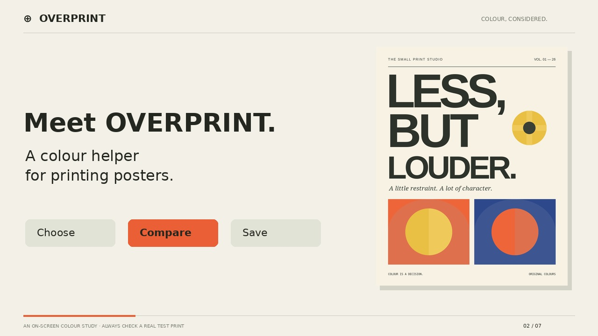
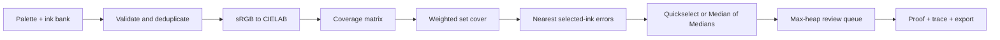

<div align="center">

# OVERPRINT
### Less ink. More intent.

**A print-palette studio where every colour decision has an explanation.**



`JAVA 17+` · `4 ALGORITHMS` · `INTERACTIVE WALKTHROUGH` · `SVG + JSON EXPORT`

**Taher Sohagpurwala · 2409540** & **Harsh Agrawal**

</div>

---

## The idea

**In plain words:** this helps you try fewer printing inks for your poster. Two similar oranges might share one ink. Look at the before and after, then decide if you like the change. The app suggests; you choose.

A poster has eight screen colours. A print studio has a limited stock of inks. Which inks should represent the palette, and which colour changes deserve a designer's attention?

OVERPRINT turns that decision into an inspectable workflow:

**Palette → colour distances → ink cover → review cutoff → priority queue → proof.**

The supplied study maps **8 unique colours to 4 stock inks** at tolerance 18. It is a screen-colour planning model, not a calibrated physical press simulator.

## Inside the studio

| Feature | What it does |
|---|---|
| Editable palette | Change swatches, add/remove colours, or import a JSON palette. |
| Ink bank | Enable available inks and edit their relative setup costs. |
| Colour tolerance | Control which target-to-ink differences are acceptable. |
| Ink ticket | Show selected inks, coverage, setup cost, baseline and p90 error. |
| Original / ink proof | Compare the same specimen before and after palette remapping. |
| Selection mode | Choose randomized Quickselect or deterministic Median of Medians. |
| Prioritized review | Inspect the largest colour changes first, using a max-heap. |
| Algorithm evidence | See actual greedy picks, error bars and recorded Java benchmarks. |
| Guided tour | Six plain-language popup steps highlight where each algorithm or structure operates. |
| Product film | A 42-second motion-graphics introduction with original music and captions using the actual specimen. |
| Exports | Save the proof as SVG and the complete input/result as JSON. |
| Honest failure states | Identify uncovered colours, invalid data and press-limit violations. |

## Algorithms that do real work

| Algorithm | Product responsibility | Complexity of this implementation |
|---|---|---|
| **Weighted greedy set cover** | Choose the ink with lowest cost per newly covered colour; repeat. | O(rmn), r ≤ min(n,m); input matrix O(nm). |
| **Randomized Quickselect** | Find the top-k error cutoff and nearest-rank 90th percentile without full sorting. | Expected O(n), worst O(n²); O(n) extra space for the copy. |
| **Median of Medians** | Alternative review cutoff using groups of five and a deterministic pivot. | Worst-case O(n) time and O(n) extra space. |
| **Binary max-heap** | Order only the k chosen review colours from largest error to smallest. | O(k) heap construction; O(k log k) for all extractions; O(k) space. |

`n` = unique artwork colours, `m` = available inks, `r` = selected inks, `k` = review count.

**Semester connection:** `Module 1 Notes.pdf`, pages 9–11, explains Quickselect; pages 11–13 discuss Median of Medians. The randomized pivot extends the selection idea and supplies CO5. The 90th-percentile calculation continues to use randomized Quickselect in either review mode. Weighted set cover and binary heaps are eligible syllabus techniques in the assessment brief.

### How weighted set cover chooses

Each ink covers the artwork colours within tolerance. At each iteration:

```text
score = ink setup cost / number of newly covered colours
pick the lowest score
mark its colours covered
repeat until covered, or no eligible ink remains
```

The default trace selects Carbon, Marigold, Vermilion and Cobalt. Each covers two colours; their scores are 0.55, 0.75, 0.95 and 1.05. Total setup weight is 6.6. The per-colour baseline also costs 6.6 for this example: fewer source colours does not imply a baseline cost saving.

Greedy is approximate. With feasible coverage and positive costs, its cost is bounded by H_n times the optimum. The press limit is checked afterwards; exceeding it does not prove that every other cover exceeds it.

### How selection and the heap work together

For errors `[2, 9, 4, 7, 1, 6]` and `k = 2`, select ascending zero-based rank `n-k = 4`. The cutoff is `7`, so the review set is `{9, 7}`. Only enough ordering to find that cutoff is needed. Equal errors are resolved in original palette order.

Quickselect picks a random pivot. Median of Medians sorts groups of at most five with insertion sort, recursively selects the median of those medians, then partitions around that pivot. It is the deterministic alternative—not another name for random selection.

The max-heap then emits the selected review entries in severity order. It orders k entries rather than sorting all n errors.

## Data structures

| Structure | Actual use |
|---|---|
| LinkedHashSet / Set | Normalize and deduplicate target colours while preserving order. |
| HashSet / Set | Reject duplicate stock inks. |
| Boolean matrix | Ink-to-target coverage within tolerance. |
| Numeric matrix | Precomputed colour distances for assignments. |
| Arrays | Selection partitions, groups of five and heap storage. |
| Lists | Selected inks, greedy trace, uncovered indices and review entries. |
| Maps / JSON objects | API input parameters and structured results. |

Collections provide supporting infrastructure. The assessed selection, heap and greedy algorithms are implemented directly.

## Run the Java application

Install **JDK 17+**, including `javac`. No npm packages, database, API key or build framework is required.

```sh
chmod +x run.sh
./run.sh
# Open http://127.0.0.1:3000
```

Windows: `run.cmd`. Change the port with `PORT=3001 ./run.sh`, or `set PORT=3001` on Windows. Inputs are not persisted; export JSON to save your work.

## Verify the algorithms

```sh
./run.sh test
java -cp build/classes studio.ExtendedTests
./run.sh benchmark
python3 scripts/test_api.py
```

The base suite has 22 named checks and 1,200 generated oracle cases. The extension suite checks five fixed cases per new algorithm, empty/invalid boundaries, 500 generated deterministic-selection cases and both API modes. The HTTP suite covers 19 integration checks.

The hosted adapter additionally checks 125 Java reference plans, 600 Quickselect order statistics, 300 deterministic-selection results, 100 heap orderings and 125 cross-mode comparisons. Recorded benchmarks are actual Java measurements; they are not hosted-runtime timings. Browser visual verification remains outstanding because the managed browser is unavailable.

## Architecture



`POST /api/plan` accepts a URL-encoded form. Optional `method` is `randomized` or `deterministic`. Outputs include `selected`, `mappings`, `uncovered`, `review`, `rankedReview`, `selectionMethod`, `reviewThreshold`, `p90`, and `trace`.

Inputs: 1–256 colours, 1–64 distinct inks, positive finite costs up to 1000, tolerance 0–100 in the API (0–60 in the UI), review count 1–256, press limit 1–64. Bodies are limited to 64 KiB.

## Repository map

```text
src/main/java/studio/   Java algorithms, planner and HTTP API
src/test/java/studio/   Correctness suites and benchmark runner
web/                   Studio UI, popup tour and product film
data/                  Six representative palette inputs
results/               Actual test and benchmark evidence
docs/                  Reports and a separate presenter guide
Dockerfile.vercel      Java container deployment definition
```

The hosted edition has a separate `worker/` adapter and `scripts/build.mjs`; it mirrors Java results and runs on a JavaScript Worker. The Java repository is the assessed implementation.

## Deploy and collaborate

`Dockerfile.vercel` packages the Java application into a stateless container listening on port 80. Vercel container deployment requires a signed-in account and available container support. No successful Vercel deployment is claimed until verified.

Git history records actual implementation stages. The downloadable `history.bundle` can be inspected with:

```sh
git clone history.bundle overprint
```

This source package is published in the project’s Git repository. The bundled `history.bundle` preserves earlier implementation stages separately; inspect it with `git clone history.bundle overprint-history`.

## Limits worth understanding

- The objective is low setup weight, not exact minimum ink count.
- Delta E76 measures a screen-colour difference; it does not simulate ink mixing, paper absorption or a printer profile.
- The cream artboard represents unprinted paper and is excluded from the ink count.
- Imported palettes recolour a fixed specimen; arbitrary artwork extraction is outside this version.
- Unmatched colours remain original in a partial proof. SVG export requires complete coverage and press-limit compliance.
- The film includes an original synthesized instrumental soundtrack and animated before/after comparisons. It is a motion-graphics product overview, not a screen recording or physical print demonstration.

**Designed to make the compromise visible. Built to make the algorithm explainable.**
